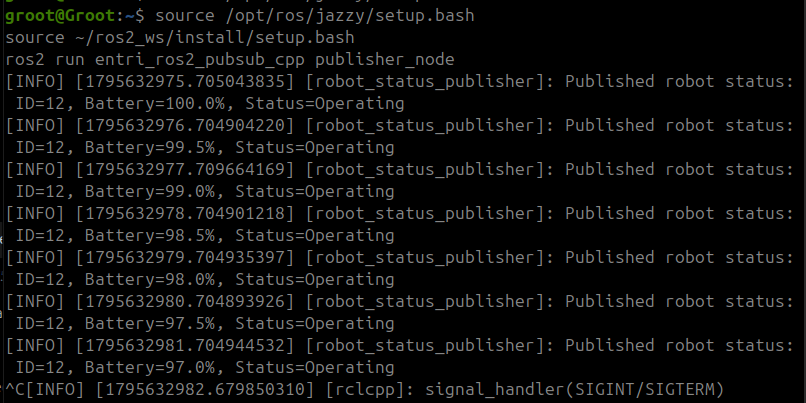
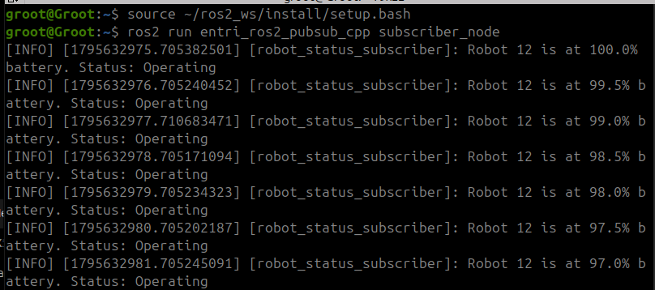

# ros2-publisher-subscriber
# ROS 2 Publisher and Subscriber

A simple ROS 2 C++ project demonstrating publisher-subscriber communication using a custom `RobotStatus` message.

## Features

- Custom message with `robot_id`, `battery_level` and `status_message`.
- Publisher sends data on the `robot_status` topic every second.
- Battery level decreases by 0.5% per message.
- Subscriber receives and displays the robot status.

## Build and Run

```bash
colcon build --packages-select entri_ros2_pubsub_cpp
source install/setup.bash
```

**Terminal 1 — Subscriber**

```bash
ros2 run entri_ros2_pubsub_cpp subscriber_node
```

**Terminal 2 — Publisher**

```bash
ros2 run entri_ros2_pubsub_cpp publisher_node
```

## Output

**Publisher**



**Subscriber**



## Requirements

- ROS 2 Jazzy
- C++
- ament_cmakeROS 2 Publisher and Subscriber(entri)
